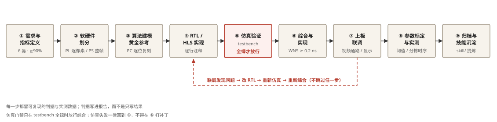
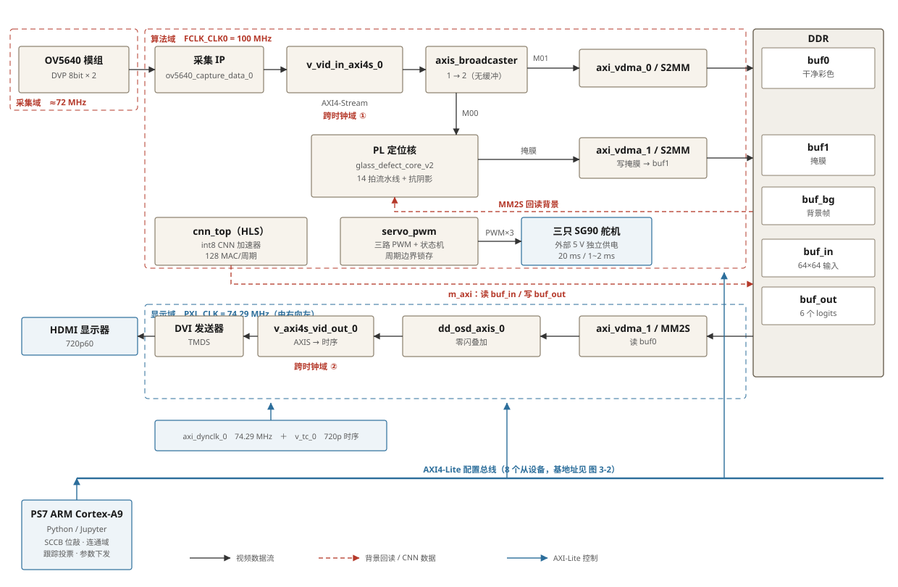
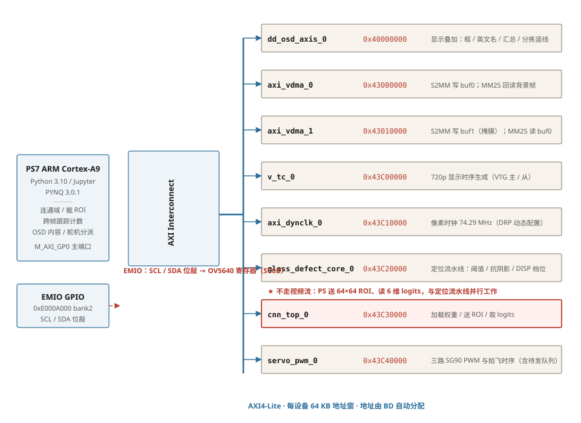
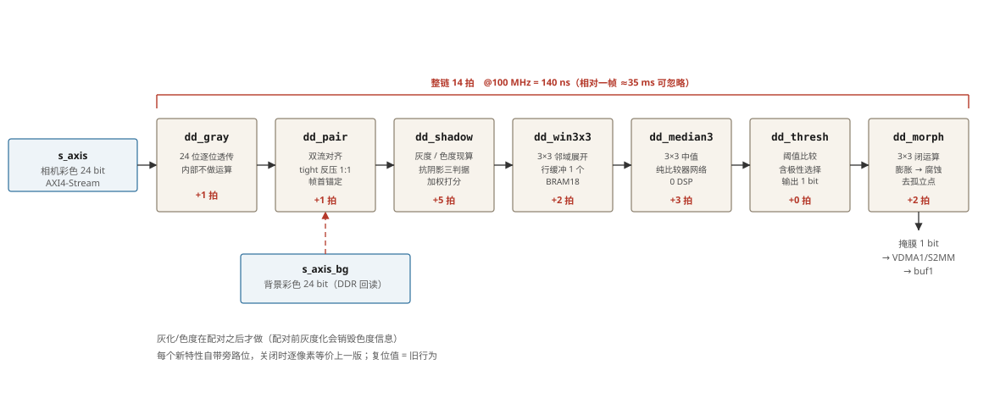
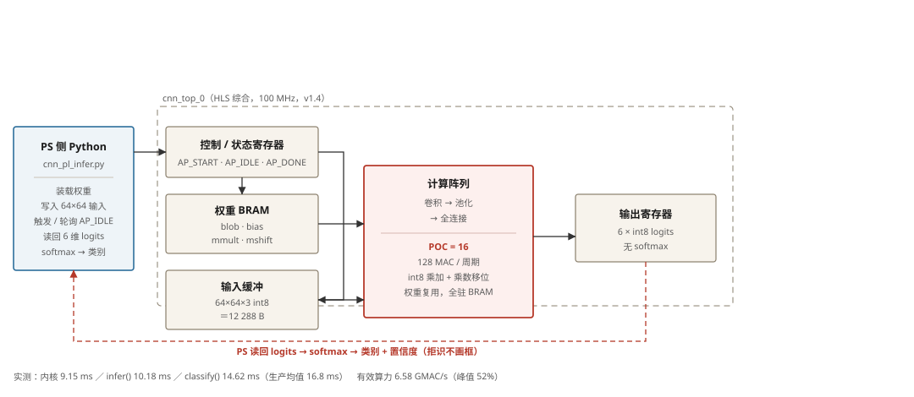

# 物品回收智能分拣系统

**基于单块 PYNQ-Z2 的端侧定位、识别与分拣一体化实现**

> 器件：AMD Zynq-7000 XC7Z020（PYNQ-Z2，xc7z020clg400-1）
> 工具链：Vivado / Vitis 2026.1；板端 PYNQ 3.0.1 / Python 3.10.4（armv7l）

---

## 目录

[TOC]

---

## 摘要

本作品实现了一套部署在单块 PYNQ-Z2 上的物品回收智能分拣系统：图像采集、目标定位、类别识别与计数全部在单板内完成，末端由三只舵机按类别把可回收物品拍离传送带完成初级分拣。

设计采用"**PL 定位与识别、PS 裁图与控制**"的软硬协同分工。PL 侧以 14 拍流水线完成双帧逐拍对齐、亮度与色度现算、抗阴影判决、3×3 中值、固定阈值二值化与形态学闭运算，直接输出目标掩膜；同时以 Vitis HLS 实现 int8 卷积神经网络加速器，在 100 MHz、128 MAC/周期的并发度下完成六类识别。PS 侧只做连通域、彩色 ROI 裁剪、跨帧跟踪计数、OSD 参数下发与舵机分派，不做任何像素级重复运算。

关键实测指标：PL 算法链整链 14 拍；目标定位 24.1 ms/帧；CNN 内核单次 9.15 ms（有效算力 6.58 GMAC/s，理论峰值 52%）；单次识别 classify 全程 16.8 ms（生产负载下）；整链循环 32.4 Hz（561 s 处理 18171 帧）；布局布线后 WNS +0.271 ns、TNS 0、无违例端点，资源占用 LUT 72.79%、FF 38.77%、BRAM 48.21%、DSP 42.27%。

系统的突出特性是：视频流全程在 PL 内以流水线流通，识别结果以 OSD 在显示通路叠加，不占用也不打断实时视频通路；多目标各由独立跟踪链管理、识别任务轮流调度，目标增多时跟踪与计数不中断；利用 YCbCr 色度不变量与亮度变化上限构建阴影判据，轻度投影阴影不产生假目标，也不会把深色物体误判为阴影。

---

## 1 作品简介

本作品是一套可放在桌面上的**物品回收智能分拣装置**。一块 PYNQ-Z2 同时承担图像采集、目标定位、类别识别、计数汇总与分拣控制，不依赖网络，也不需要上位机。把物品放到传送带上，显示器实时给出识别框与英文类别名，画面一侧实时累计"可回收 / 不可回收"数量；传送带末端的舵机在物品越过分拣线后按类别把它拍进对应料口，完成初级分拣。

### 1.1 功能与特性

| 功能 | 实现与表现 |
|---|---|
| 目标定位 | 与空场景背景差分，逐帧输出画面内全部待分类目标的掩膜，多目标可同时存在 |
| 类别识别 | 六类：香蕉皮 / 易拉罐 / 纸壳 / 橘子皮 / 塑料瓶 / 纸巾；推理在 PL 内的 int8 CNN 加速器完成 |
| 计数与汇总 | 每个目标一条独立跟踪链，静止不重复计数、短暂遮挡不重开计数；实时输出"可回收 X / 不可回收 Y" |
| 抗阴影 | 投影阴影不产生假目标，深色物体不被误判为阴影 |
| 零闪显示 | 框、英文类别名、汇总、分拣线全部与视频同屏，叠加不打断视频通路、不产生闪烁 |
| 初级分拣 | 三路 SG90 按"越线时刻"把可回收物拍离传送带；同类连续到达时排队顺延，动作不丢失 |
| 拒识 | 置信度不足时报"未知"，不画框、不计数 |

### 1.2 应用领域

面向**无人值守的初级分拣场景**：社区回收点、小型分拣站、无人值守回收箱，以及需要"看得见分类过程"的教学与演示场合。本作品的价值不在替代完整工业分选线，而在于用一块低成本单板把"识别 + 计数 + 动作"闭环做到本地、可解释、可复制。

### 1.3 主要技术特点

| 技术点 | 做法 | 收益 |
|---|---|---|
| PL 内完成定位 | 背景差分流水线，整链 14 拍 | 逐像素运算不进 CPU，定位 24.1 ms/帧 |
| PL 内完成识别 | Vitis HLS int8 CNN 加速器，POC=16、128 MAC/周期 | 单次推理 9.15 ms，有效算力 6.58 GMAC/s（峰值 52%） |
| 软硬协同划分 | 按"逐像素/整帧""恒定代价/随机访问"两条判据切分 | PS 侧不做重复运算，整链循环 32.4 Hz |
| 显示通路内叠加 | OSD 放在 VDMA 读出之后、时序生成之前 | 叠加零闪，且不与识别争抢带宽 |
| 抗阴影判据 | 色度不变 + 变暗 + 暗度有上限三条合取 | 阴影与深色物体在单像素层面分开 |
| 分拣时序 | 越线帧触发 + 每路独立延时 + 2 位待发队列 | 分拣与识别时刻对齐，同路可排队而非丢弃 |

### 1.4 主要性能指标

| 指标 | 实测值 | 测试条件 |
|---|---|---|
| 图像输入 | 972 × 720 @ 28.6 fps | OV5640 DVP 接口，关闭内部彩条 |
| PL 定位耗时 | 24.1 ms / 帧 | 读掩膜 + 连通域 + 过滤合并（板端实测） |
| 识别预处理 | ≈ 8 ms / 次 | ROI 裁剪 + letterbox + 归一化量化（生产负载实测） |
| CNN 内核耗时 | 9.15 ms / 次 | 单次推理，权重常驻片上 |
| 单次识别全程 | 16.8 ms / 次 | `classify()` 生产负载均值，含预处理与 softmax |
| 单目标整帧耗时 | ≈ 41 ms | 定位 24.1 + 识别 16.8（**有目标帧**；无目标帧只做定位，因此平均循环率达 32.4 Hz） |
| 有效算力 | 6.58 GMAC/s | 理论峰值 12.8 GMAC/s 的 52% |
| 整链循环 | 32.4 Hz | 561 s 连续处理 18171 帧 |
| PL 流水线延迟 | 14 拍 ≈ 140 ns | @100 MHz |
| 分拣动作间隔 | ≥ 1.4 s / 路 | `T_DLY + T_ACT + T_RET` |
| 资源占用 | LUT 38 726（72.79%）· FF 41 248（38.77%）· BRAM 67.5（48.21%）· DSP 93（42.27%） | 布局布线后 |
| 片上功耗 | 2.79 W（动态 2.60 / 静态 0.19，其中 PS7 1.54 W、PL 动态 1.07 W） | 布局布线后 `report_power`，向量无关估算 |
| 时序 | WNS +0.271 ns · WHS +0.050 ns · TNS 0 | 三个时钟域全部收敛 |

---

## 2 选题背景与创新点

### 2.1 背景与现实痛点

在社区回收点、小型分拣站和无人值守回收箱等场景中，"把物品放上输送带—识别它是什么—按类别分流"这一步长期依赖人工。人工分拣的三个现实困难是：一是分拣决策依赖经验，标准不统一；二是重复性体力劳动强度大、枯燥，人员流动率高；三是回收点普遍缺少稳定的算力与网络条件，云端方案难以落地。

这类场景对技术方案的约束很明确：**低延迟**（物品在带上是运动的，判断必须跟得上）、**本地化**（无稳定网络）、**低成本**（单板即可部署）、**可解释**（现场需要看到"它认成了什么"，而不是只给一个数字）。

### 2.2 已有方案与本设计的差异

针对同类需求，已有做法大致三类，各自的局限如下：

| 已有方案 | 典型形态 | 局限 |
|---|---|---|
| 纯 PC / 工控机视觉 | 工业相机 + 工控机 + GPU 或 CPU 推理 | 成本与体积高；CPU 侧串行处理，逐像素运算与推理争抢同一份算力，实时性靠堆硬件换取 |
| 云端方案 | 摄像头 + 边缘盒子 + 云推理 | 依赖网络，往返延迟不可控；回收点常无稳定链路 |
| 纯 PS 嵌入式方案 | 单板 Linux + Python 处理整链 | 逐像素算法在 CPU 上是纯串行，实测整链只能到个位数帧率，无法跟上运动物体 |

本设计的差异在于**把"逐像素、代价恒定"的运算整体搬到 PL 并做成流水线，把"跨帧记忆与决策"留在 PS**，同时进一步把神经网络推理也做进 PL——即不只是"PL 预处理 + PS 识别"，而是"**PL 定位 + PL 识别**"，PS 只承担控制与调度。这样单板即可在无网络、低成本条件下完成端到端闭环。

### 2.3 本设计的定位与适用边界

系统面向**无人值守的初级分拣场景**：对具有一定回收价值的物品，按既定标准做出初级分类与分拣。

适用边界（如实声明）：光照充足且背景下并非特别杂乱的固定场景；传送带为纯色哑光表面；物品一次性出现在画面内且相互不重叠。超出该边界（强反光、密集堆叠、极端弱光）时性能会下降。

### 2.4 创新点

1. **PL 内完成"定位 + 识别"双段加速**：像素级定位链（14 拍流水线）与 int8 CNN 加速器同处一块 PL，识别不再占用 CPU；单次识别 9.15 ms，有效算力达到理论峰值的 52%（对应 3.5、5.2 节实测）。
2. **零阻塞的显示与识别并行**：OSD 叠加放在显示通路的 MM2S 之后，视频流与识别流互不抢占，叠加不产生闪烁（对应 5.2 节"零闪"项）。
3. **基于色度不变量的抗阴影判据**：以"色度不变 + 变暗 + 暗度有上限"三条合取判决，把投影阴影与深色物体在单像素层面分开（对应 3.4、4.3 节）。
4. **按过线时刻投递的分拣时序**：以"目标质心越过触发线"的帧作为投递时刻，同通道连续请求进入待发队列而非丢弃，使分拣时序与目标被识别的时刻严格对齐（对应 4.4 节）。
5. **以背景差分为定位预处理，把识别从"整图推理"降为"目标级推理"**：固定场景下物品只需被"找到"和"认出"，不需要在整幅画面上做稠密检测。本设计用 PL 的逐像素背景差分把"哪里是目标"算成二值掩膜（固定 14 拍延迟），识别网络因此只对每个目标的 ROI 做一次 64×64 推理 —— 每帧推理次数由目标个数决定（实测均值 0.32 次/帧），而不是由画面面积决定。按同一内核 9.15 ms 估算，若改为不定位的整图滑窗，一帧需 609 次推理、约 5.6 s（0.18 fps），比本设计低两个数量级以上（对应 5.5 节量化对比）。定位不占模型容量，分类网络也就只需保留一档小模型（0.39 MB 权重、60.2 MMAC），从而在同等资源下留出扩展类别的余地。

### 2.5 设计流程

设计按"先建模、再仿真、后综合、最后上板"的顺序推进，每一段都有明确的放行判据。算法先在 PC 端做成逐位复刻的黄金参考，RTL 与 HLS 实现与之逐字节比对；RTL 改动先过 `xvlog` + `xelab`，再跑对应 testbench，**全绿才允许综合**；综合只接受时序余量 ≥ 0.2 ns 的结果；上板后所有参数以实测毫秒数与寄存器回读为准。任何一步失败都整段回退，不在下游打补丁。



---

## 3 设计原理与功能框图

### 3.1 系统总体架构

系统按三个时钟域组织：**采集域**（摄像头 PCLK 约 72 MHz）、**算法域**（FCLK_CLK0 100 MHz，全部视频流、AXI-Lite 配置与 DDR 通路都在此域）、**显示域**（像素时钟 74.29 MHz）。全系统只有两个跨时钟域点：`v_vid_in_axi4s`（72 MHz→100 MHz，IP 内部异步 FIFO）与 `v_axi4s_vid_out`（100 MHz→74.29 MHz）。



缓冲与几何：帧缓冲 1280×720×3，图像区宽 972、行跨距 1280（左右黑边），相机侧输出 972×720 @ ≈28.6 fps。

除视频通路外，系统还有一条独立的 **AXI-Lite 控制通路**：PS 经它访问八个从设备（搬运、显示时序、像素时钟、定位核、CNN 加速器、舵机 PWM、OSD 叠加），完成参数下发、状态回读与启动控制。



### 3.2 视频通路：所用官方 IP 的调用方式

视频通路按 Xilinx 标准视频 IP 参考流程组织[15][16]，由采集接口、AXI4-Stream 视频域、VDMA 搬运与显示时序四段构成。骨架搭建完成后，在本设计中完成了时序收敛、跨时钟域、帧同步与 DDR 带宽等一系列联调工作。各 IP 的作用与本设计采用的关键配置如下：

| IP | 作用 | 本设计关键配置 | 调用要点 |
|---|---|---|---|
| `clk_wiz_xclk` | 为摄像头提供 XVCLK | FCLK 100 MHz → 24.000 MHz | 模组侧无晶振，主时钟必须由 FPGA 提供 |
| 采集 IP | DVP 8 bit × 2 拼一像素 | 每 2 个 PCLK 出 1 像素 | 输出 `frame_clk/frame_ce` 直接驱动下游；输出为 RGB565 左对齐补 0 |
| `v_vid_in_axi4s` | 原生视频时序 → AXIS | `C_PIXELS_PER_CLOCK=1`，RGB，8 bit/分量 | 内部异步 FIFO 顺带完成跨时钟域；`tready` 长时间拉低会丢像素且不报错 |
| `axis_broadcaster` | 1 路复制为 2 路 | 1 slave / 2 master | **无缓冲**：`s_axis_tready` 为两路 tready 相与，任一路不接收即全链路反压 |
| `axi_vdma` ×2 | DDR 搬运 | `C_INCLUDE_SG=0`（直接寄存器模式）、`C_NUM_FSTORES=3`、AXIS 24 bit、`TUSER` 1 bit、`C_MM2S_SOF_ENABLE=1`、内部 GenLock（S2MM 动态主 / MM2S 动态从） | 启动顺序：RESET→等 HALTED→HSIZE/STRD_FRMDLY→START_ADDR→FRMSTORE→清 PARKPTR→写 CR→**最后写 VSIZE 才触发搬运** |
| `v_tc` | 显示时序生成 | `VIDEO_MODE=720p` 且 `C_GENERATE_EN=1`（H=1650 / V=750 / HACTIVE 1280 / VACTIVE 720，时序随 IP 固化） | 只写 `CTL=0x03F7EF06`；生成器时序寄存器（0x60~0x94）一律不覆盖 |
| `v_axi4s_vid_out` | AXIS → 显示时序 | `C_VTG_MASTER_SLAVE=1`（VTG Slave） | 与 `v_tc` 的 `gen_clken` 不互锁，使能接常量 |
| `axi_dynclk` | 像素时钟 | 100 MHz 参考 → **74.2857 MHz**（`PXL_CLK_5X_O`≈371.43 MHz 给 DVI） | 74.25 MHz 无法由 MMCM 精确合成（100/74.25=400/297，M≤64），需 DRP 动态配置 |
| DVI 发送器 | TMDS 输出 | `pclk` / `pclk_x5` 由 `axi_dynclk` 提供，`reset_n ← LOCKED_O` | MMCM 未锁定时发送器常复位，表现为无信号 |

### 3.3 视频通路联调中解决的问题

标准 IP 用对之后通路才能通。以下问题均在本设计中定位并解决，按"现象 / 根因 / 定位判据 / 修法"记录：

| 现象 | 根因 | 定位判据 | 修法 |
|---|---|---|---|
| 显示侧 IP **一帧都不接收数据** | 显示侧 AXIS→时序 IP 的主从方向选错，与 VTC 的 `gen_clken` 形成互等死锁 | 该 IP 的 `sof_state_out` / `status` 长时间不动 | 改 Slave、断开互锁线、使能接常量 |
| 屏幕全黑，但 PS 侧 SCCB、VDMA 状态、寄存器回读**全部正常** | PS7 的 FCLK0 分频是派生参数，BD 中修改无效；生成 `.hwh` 时仍为 4/4 ⇒ PL 实际只有 62.5 MHz | 加载后读 `Clocks.fclk0_mhz` 不等于 100 | 在 `.hwh` 中脚本化打补丁 `DIVISOR0=10 / DIVISOR1=1`，并加入加载自检 |
| 运动物体**一顿一顿并出现重影**，静止画面完全正常 | VDMA 多帧环中 GenLock 未启用（`CR_SYNC_EN`=0x8），读指针以显示帧率在 3 帧环内套圈 | 只在有运动时出现 ⇒ 优先查帧同步 | S2MM `CR=0x0B`、MM2S `CR=0x800B`（含 GENLCK_RPT，无新帧时重复上一帧） |
| 帧率测出来只有真值的 1/3 | 只统计了 3 帧环中的 1 个缓冲 | 改用 `PARKPTR` 的当前读帧号计数 | 修正测量方法，得 28.6 fps |
| 读缓冲"完全没更新" | CPU 缓存未失效，读到的是旧值（假阴性） | 同一缓冲两次读数完全相同 | 读前 `invalidate`、写完 `flush` |
| 画面被"拦腰切开"或差分全黑 | 差分级输出节拍跟了背景流而非相机流，几何错位 | 掩膜几何由相机流节拍决定 | 输出严格跟随相机流节拍 |
| 奇数行行首出现错位 | VDMA 行字节数 972×3=2916 不是 AXI 64 bit（8 字节）的整数倍 | 真 VDMA 仿真：beat 序号正确但数值错 | 量化影响（受影响像素 0.475%，其中 93.7% 差值 < 8 级）后**决定不改**，由阈值兜底 |
| 显示器黑屏或进入省电 | 该显示器只接受 720p60（实测拒绝 30 Hz 刷新） | 换刷新率即熄屏 | 固定 720p60 输出 |

### 3.4 PL 定位流水线（整链 14 拍）



| 级 | 模块 | 延迟 | 职责 |
|---|---|---|---|
| ① | `dd_gray` | +1 | 24 位彩色**逐位透传**，内部不做任何运算（模块名沿用早期命名）。保留 1 拍寄存用于切分组合链；灰度化会销毁色度，而抗阴影依赖色度，故一律推迟到第③级 |
| ② | `dd_pair` | +1 | 当前帧 A 与背景帧 B 的逐拍配对：紧反压 1:1 + 帧首锚定（核心不变式：挂起时队首必为 B 的首像素） |
| ③ | `dd_shadow` | +5 | 现算 Y / Cb / Cr，按"色度不变 + 变暗 + 暗度有上限"输出判决分 |
| ④ | `dd_win3x3` | +2 | 3×3 行缓冲窗口生成 |
| ⑤ | `dd_median3` | +3 | 19 比较器中值（可旁路） |
| ⑥ | `dd_thresh` | 0 | 固定阈值二值化（极性可配） |
| ⑦ | `dd_morph` | +2 | 3×3 闭运算（可旁路） |

亮度与色度都在第③级 `dd_shadow` 内由 24 位彩色**现算**，第①级只负责透传：亮度用 2:4:1 权重 `S=2(R5+G6)+B5`、`Y=S+(S>>3)`（权重偏差 0.058、有效档位 220、零 DSP 消耗）；色度按 BT.601 定点式 `Cb×256 = −43R − 85G + 128B`、`Cr×256 = 128R − 107G − 21B`，两组系数之和恰为 0——这正是"同一材质被等比例压暗时色度严格不变"的数学依据[3]。

### 3.5 CNN 硬件加速器

加速器由 Vitis HLS 生成，采用**输出通道驻留**的切分方式：权重常驻片上 BRAM，激活张量放在带量化零点边框的 arena 中，行缓冲 + 滑动窗口供数，累加器驻留寄存器。并发度 POC=16 × PIC=8 = 128 MAC/周期 @100 MHz。权重以显式 64 位宽字读入（`reinterpret_cast<const ap_uint<64>*>`），把载入循环的迭代间隔从 128 拍降到 16 拍。网络为 4 层 3×3 卷积（32/64/128/256 通道）+ 三次 2×2 最大池化 + 全局平均池化 + 全连接 6 类，输入 64×64×3，整网 60.2 MMAC。网络按"分类只需目标局部感受野、定位交给前面的定位链"的思路设计，结构取轻量网络一档[4][5]；FPGA 侧采用输出通道驻留的流式加速架构[11]，其中的分块方式、权重复用与累加器驻留策略沿用嵌入式 FPGA 卷积加速的既有研究[9][10][12][13]；int8 定点语义按整数算术推理规范实现并与 TFLite 逐位对齐[6]，量化误差控制参考量化白皮书[7]，板端推理框架的取舍参考 TinyML 侧的实现[8]；HLS 侧的流水线与存储约束按官方综合指南处理[14]。

**部署策略**（把"训练好的 int8 模型"变成"可被 PS 驱动的 AXI 从设备"）：

| 策略 | 做法 | 目的 / 代价 |
|---|---|---|
| 定点化 | 权重 per-channel int8、激活 int8、偏置 int32（权重合计 388 KB、zero-point 全 0） | 权重体积缩到 1/4，全部放得进片上 BRAM |
| 权重常驻 | 权重按 (输出通道块 × 3×3 × 输入通道块) 切片，运行前一次性搬入片上，推理期间不再读 DDR | 消除每帧数百 KB 的 DDR 往返；代价是 BRAM 占用 67.5/140 块 |
| 单核复用 | 四层共用一套计算单元，层参数由描述表在运行时切换 | 四层各配一套乘法器需 256 个 DSP（超出 220 上限），单核复用后 DSP 只用 93 |
| 无边界判断的内循环 | 激活张量四周各补 1 像素"量化零点边框"，行步长分别取 66/34/18/10 | 内层循环里不出现条件分支，HLS 才能把流水线压到 II=1 |
| 池化前移合并 | 最大池化融进 requant 那一遍，且 max 在 int32 累加值上取（requant 单调，等价） | 省去一次完整张量读写，省约 3/4 的池化算力 |
| 输出打包 | 6 个 logits 打包成 2 个 int32 写回 DDR，PS 侧解包 | 只跨总线传 8 字节，避免大块回读 |
| 接口收敛 | 只暴露 6 个基地址寄存器（权重/偏置/乘数/移位/输入/输出）+ 控制状态寄存器 | PS 侧驱动只有"写地址、写启动、等完成、读结果"四步 |

**量化对齐**：PC 端用逐位复刻 TFLite int8 语义的 numpy 参考实现（含 `QuantizeMultiplier` / `SaturatingRoundingDoublingHighMul` / `RoundingDivideByPOT`）作为黄金参考，HLS 的 C 仿真与之逐字节比对；上板后再用同一份 `golden_in.bin` 做内核自检，保证"训练端—参考实现—硬件"三者输出一致。

**PS 与 PL 的边界**：PL 承担全部逐像素运算与全部推理（定位固定 14 拍延迟、单次推理 9.15 ms），整个过程中不占用 CPU；PL 侧只认"起点地址 + 启动位"，做完置完成位。PS 只做控制与调度 —— 位流与时钟/摄像头/搬运通道的初始化、掩膜读回与连通域、ROI 裁剪、跨帧跟踪与投票、OSD 参数下发、分拣投递；**PS 侧不执行任何逐像素运算**。



### 3.6 PS 侧功能

PS 侧不重复任何像素级运算，只做五件事：

1. **连通域与目标框**：掩膜按行、列各取 1/2 读（数据量 1/4），坐标乘回后外扩 4 像素；不重复二值化、不做额外形态学（PL 已完成）。
2. **彩色 ROI 裁剪**：从干净彩色缓冲按掩膜框裁 ROI，水平方向补偿 14 列、垂直 2 行的固定偏移，再 letterbox 到 64×64。
3. **跨帧跟踪与计数**：质心距离匹配（阈值 0.6×max(宽,高)）、3 帧确认、12 帧丢失删除；每帧轮转识别 1 个目标，每个目标保留最近 5 次结果做多数投票。
4. **OSD 参数下发**：把框、名称、汇总与分拣线写入 OSD 元素槽（共 8 槽：6 目标 + 1 汇总 + 1 分拣线）。
5. **分拣分派**：质心越过触发线（掩膜第 494 列 = 屏幕第 640 列）且目标已确认、未处理过时，按类别写舵机 KICK 寄存器。

### 3.7 硬件：机械结构与电路连接

**机械部分**：一条约 40 cm 的桌面级传送带，带面为纯色哑光、无接缝材料，物体由右向左单向运动；末端并列三只 SG90 舵机，各带一片轻质挡片。为避免连续动作时抓取失败，本设计采用"拍飞"而非"导流"：挡片在物体越过分拣线后的设定延时到点后瞬时摆出，把物体拍离带面，随后立即回中。

后台背景的采集条件是机械部分的一条硬约束：**必须在传送带运转且带面空无一物时采一次背景并冻结**。带面若有接缝或花纹，背景差分会在每帧同一位置产生固定假目标。

**电路部分**：

| 部分 | 连接方式与要点 |
|---|---|
| 主控 | PYNQ-Z2（Zynq-7000 XC7Z020），12 V 供电，HDMI 输出至显示器 |
| 摄像头 | OV5640 模组经 PMOD-CAMERA v1.0 转接板接入，**跨排对接**（主排 pad 1–6 对转接板 7–12），数据位相邻互换；XCLK 由 FPGA 的时钟向导提供 24 MHz（模组侧无晶振） |
| 摄像头控制 | SCCB（SCL/SDA）由 PS 侧 EMIO GPIO 位敲，严格开漏；模组 RESET 上拉、PWDN 下拉，由转接板电阻固定，FPGA 不引出 |
| 舵机 | 三路 PWM 由 PL 产生，信号经排针引出；**舵机电流回路闭合在外部 5 V 侧，棕线不接板上 GND，另引一根细线做 0 V 参考**，避免动作瞬间电流拉塌逻辑地 |
| 显示 | 720p60 的 HDMI 显示器（实测该屏只接受 60 Hz 刷新，30 Hz 会熄屏） |

摄像头的 SCCB 寄存器、DVP 时序与输出格式均以器件手册为准[17]。

### 3.8 软件界面与操作

板端运行 Jupyter，操作集中在一个自建的图形控制台（`ui.py`）里。该控制台**加载时只搭建界面，不执行任何硬件动作**；烧位流、跑采集、加载识别、采背景、开始识别全部只能由按钮触发，便于在演示与调试时精确控制每一步的时机。

| 按钮 | 动作 |
|---|---|
| ① 加载位流 | 运行硬件初始化脚本：位流下载、FCLK0 频率自检、SCCB 配置、显示时序、四条 VDMA 与帧同步、算法槽位自检 |
| ② 加载识别 | 依次运行配置、定位、识别、自检、分拣五个脚本，末尾打印一行"加载识别结果汇总"（句柄类型 / 自检结论 / 关键寄存器回读） |
| ③ 采集背景 | 抓取当前空场景彩色帧作为背景，冻结后交给 PL 的第二入口 |
| ④ 开始识别 | 在后台线程启动实时循环：定位 → 裁图 → 识别 → 计数 → 叠加 → 分拣 |
| ⑤ 中止 | 停止循环并清空叠加 |

参数面板提供阈值、抗阴影权重、显示档位，以及**每路舵机单独的两行参数**（中位脉宽、动作角度、延时、保持时间、回中斜坡、反向），用于现场标定。

---

## 4 软硬件划分依据与接口设计

### 4.1 划分判据

划分只遵循一条判据：**代价是否恒定、是否需要跨帧记忆**。

| 运算 | 特征 | 归属 |
|---|---|---|
| 灰度/色度、配对、中值、阈值、形态学 | 逐像素、代价恒定、天然可流水 | **PL** |
| CNN 卷积推理 | 计算密集、权重固定、可完全并行 | **PL**（HLS） |
| 连通域标记、跨帧跟踪、投票、分派 | 需要整帧视野与跨帧状态 | **PS** |
| OSD 坐标与文字、舵机参数 | 随机访问、低频 | **PS 写寄存器，PL 执行** |

### 4.2 地址映射与主要寄存器

各从设备分配 64 KB 地址空间（控制通路框图见 §3.1 的 图 3-2）：

| 从设备 | 基地址 | 说明 |
|---|---|---|
| 显示叠加（OSD） | 0x4000_0000 | 元素槽区 0x4C + 32k |
| 视频搬运 VDMA0 | 0x4300_0000 | 原图/背景通道 |
| 视频搬运 VDMA1 | 0x4301_0000 | 掩膜/显示通道 |
| 显示时序 VTC | 0x43C0_0000 | |
| 动态像素时钟 | 0x43C1_0000 | |
| PL 算法核 | 0x43C2_0000 | 检测核寄存器（见附录 A） |
| CNN 加速器 | 0x43C3_0000 | 6 个基地址 + 控制/状态 |
| 舵机 PWM | 0x43C4_0000 | 三通道独立参数（见附录 A） |

### 4.3 抗阴影判据

对每个像素同时计算当前帧亮度 `Y_A`、背景亮度 `Y_B` 与色度差，判决为阴影需同时满足：

- 色度不变：`|ΔCb| + |ΔCr| < τc`（τc ≥ 8，由 RGB565 量化步长决定）
- 变暗：`Y_A < Y_B`
- 暗度有上限：`Y_A × 256 > Y_B × αmin`

第三项不可省略——否则"变暗即抹除"会把黑色物体一并杀掉。最终判决分 `score = wY·(阴影?0:|ΔY|) + wC·(|ΔCb|+|ΔCr|)`，权重与阈值均由寄存器下发，置零即可退回纯亮度差模式。"阴影 = 背景的较暗版本"这一判据源于移动阴影检测与评估的系统性研究[3]。

### 4.4 分拣时序

- 触发线固定在掩膜第 494 列（屏幕第 640 列，画面正中）；"曾在来向一侧出现过"作为必要条件，凭空出现在线后的目标不触发。
- 类别到通道映射为固定的三类一对一（易拉罐→通道 1、塑料瓶→通道 2、纸壳→通道 3），不可回收三类只识别不分拣。
- 触发判据同时要求"本帧可见 + 已确认 + 未处理过 + 曾在线前出现 + 已越线"，保证每个目标只触发一次。
- 同通道连续请求进入 2 位待发队列（饱和值 3），队列深度通过 STATUS 寄存器暴露给上层。

---

## 5 优化过程与性能对比

### 5.1 优化主线

优化围绕一个目标展开：**在单板、单 PL、100 MHz 的约束下，把"定位 + 识别"压进相机帧周期（34.5 ms）**。过程分三步：

1. 定位链下放 PL（取消 PS 侧重复的像素级处理）；
2. 识别从 PS 的 tflite 推理迁移到 PL 的 HLS 加速器；
3. 逐项压缩两个环节的固定开销（并发度、权重载入、量化查表、采样率）。

### 5.2 优化前后对比

| 优化项 | 改前 | 改后 | 收益 |
|---|---|---|---|
| 识别执行位置 | PS（tflite_runtime，整链单线程） | **PL（HLS 加速器）** | 单次识别 65.53 ms → **9.15 ms（内核）** |
| 单次识别（含预处理/softmax） | PS 双核约 44 ms | **16.8 ms（生产负载）/ 14.62 ms（空载）** | 2.4–2.6× |
| 卷积并发度 | POC=8（64 MAC/周期） | **POC=16（128 MAC/周期）** | 内层迭代 1,032,192 → 516,096 |
| 权重载入 | 逐字节读，II=64 | **显式 64 位宽字读，II=16** | 载入 3.9 ms → 0.49 ms |
| 定位链实现 | PS 全分辨率读掩膜 + 二值化 + 闭运算 | **PL 流水线 + PS 隔行隔列 1/4 读** | 265 ms/轮 → **25.1 ms/帧** |
| 目标定位 | 同上 | 24.1 ms/帧（生产） | 10.6× |
| 整链循环率 | 16.6 Hz（PS 串行） | **32.4 Hz（实测 18171 帧 / 561 s）** | ≈1.95× |
| 有效算力 | 2.62 GMAC/s | **6.58 GMAC/s（峰值 52%）** | 2.51× |
| 显示叠加 | 叠加占用显示缓冲，切换时闪烁 | OSD 插在显示通路 MM2S 之后 | **零闪**，视频流不被打断 |

### 5.3 资源与实现结果

| 项目 | 数值 |
|---|---|
| Slice LUT | 38,726 / 53,200（72.79%） |
| FF | 41,248 / 106,400（38.77%） |
| BRAM | 67.5 / 140（48.21%） |
| DSP | 93 / 220（42.27%） |
| 时序 | 100 MHz 下 WNS **+0.271 ns**、WHS +0.050 ns、TNS 0、无违例端点 |
| 关键路径位置 | 不在 CNN 内核，而在显示叠加通路的组合路径 |

### 5.4 关键优化的原理说明

- **POC 8→16**：输出通道驻留的前提下，每次内层迭代多算 8 个输出通道，权重 tile 与输入窗口的复用次数翻倍，MAC 利用率上升；代价是 DSP 由 52 增至 84、仍需配合权重宽读才能把 II 压住。
- **权重宽读**：单端口 m-axi 的迭代下限等于字节操作个数，因此把"一字节一字节读"改为"一次读 64 位再切片"，II 从 128 降到 16，同时减少逐字节多路选择的 LUT 消耗。
- **预处理 LUT 化**：量化的 `(x - mean)/std / scale` 复合映射对 8 bit 输入只有 256 种取值，预先算表后每像素退化为一次查表，消除了每帧的量化运算。
- **定位链隔行隔列读**：目标是百像素级大块，按行、列各取 1/2 后仍完整成块，坐标乘回 2 倍、误差被 4 像素外扩吸收，读取数据量降到 1/4。
- **移除 PS 侧重复运算**：PL 输出已是 0/255 二值掩膜，PS 再次二值化（约 14.9 ms）与再做 5×5 闭运算（约 139.3 ms）都不改变目标数，属于纯重复，全部删除。

### 5.5 定位预处理带来的推理量下降：耗时剖面与对比

固定场景下的一个关键判断是：**"在整幅画面里找出所有物体"与"认出一个已经框好的物体"是两件不同量级的事**。本设计把前者交给 PL 的逐像素背景差分，把后者交给 CNN，因此网络只需要处理 64×64 的目标 ROI，而不是 972×720 的整幅画面。

**（1）单帧耗时剖面（有目标时，板端实测）**

| 阶段 | 执行位置 | 耗时 | 说明 |
|---|---|---|---|
| 背景差分定位链 | PL | 14 拍 ≈ 140 ns | 与像素流同步，不进入 CPU 时间账 |
| 读掩膜 + 连通域 + 过滤合并 | PS | 24.1 ms | 掩膜按行、列各取 1/2 读，数据量降到 1/4 |
| ROI 裁剪 + letterbox + 归一化量化 | PS | ≈ 8 ms | 量化已按每通道 256 项查表实现 |
| int8 CNN 推理 | PL | 9.15 ms | 128 MAC/周期 @100 MHz |
| 解包 + softmax + 记分 | PS | ≈ 1.3 ms | |
| **单目标整帧合计** | | **≈ 41 ms** | 与连续循环实测 40.9 ms（24.1 + 16.8）一致 |

**（2）同一模型放在 PS 与放在 PL 的对比（实测）**

| 执行位置 | 单次耗时 | 相对 PL 内核 |
|---|---|---|
| PS `tflite_runtime`，仅 `set_tensor + invoke`（单线程） | 65.53 ms | 7.2× |
| PS `tflite_runtime`，`classify()` 全程（双线程，含预处理与 softmax） | ≈ 44 ms | 4.8× |
| **PL HLS 加速器，内核（纯推理）** | **9.15 ms** | 1.0× |
| PL HLS 加速器，`classify()` 全程（空载 14.62 / 生产 16.8） | 16.8 ms | 1.8×（相对 44 ms 为 2.6×） |

**（3）若去掉背景差分定位，改为整图推理**

分类网络只接受 64×64 输入，因此"不做定位"只有两条路：

| 做法 | 每帧推理次数 | 单帧推理耗时 | 结论 |
|---|---|---|---|
| 整幅 972×720 缩放到 64×64 跑一次 | 1 | 9.15 ms | 不可用：缩小约 15 倍，带面物品在输入中不足 1 像素 |
| 同模型滑窗遍历（窗口 64、步长 32） | 29 列 × 21 行 = **609 次** | **≈ 5.6 s**（0.18 fps） | 不可用：比相机 28.6 fps 低约 158 倍 |
| **本设计：背景差分定位 + 目标级推理** | 目标个数（实测均值 **0.32 次/帧**） | 平均 ≈ 3 ms | 整链 32.4 Hz，跟得上相机 |

背景差分因此不是"额外的预处理"，而是**把推理次数从"由画面面积决定"改成"由目标个数决定"的那一步**。这类"空场景采一次、之后冻结"的用法本身就是背景减除类方法的既定工作方式（学习率置 0 即停止更新）[1][2][3]。也正因为像素级的分割、配对与阴影抑制都由 PL 以固定延迟完成、完全不占模型容量，分类网络才可以只用一档小模型（0.39 MB 权重、60.2 MMAC、输入 64×64）—— 这就是"更小的模型也能认更多物品"的原因：类别扩展只需重训并重导末端权重，PL 结构与定位链都不用改。

**（4）功耗（布局布线后 `report_power`，向量无关估算）**

| 项 | 功耗 |
|---|---|
| 总片上功耗 | 2.790 W |
| 动态 | 2.603 W |
| ├ PS7 | 1.536 W |
| ├ PL 动态（时钟 0.117 + 逻辑 0.173 + 信号 0.242 + BRAM 0.070 + MMCM 0.229 + DSP 0.083 + I/O 0.154） | 1.067 W |
| 静态 | 0.187 W |
| 估算结温 | 57.2 °C（有效 ΘJA 11.5 °C/W，环境 25 °C） |

说明：该结果为向量无关（vectorless）估算；未提供仿真活动文件时，I/O 与内部节点的翻转率取默认假设，报告自身标注置信度为 Low。数量级可用于选型与散热评估，精确值需以板上实测或带活动文件的功耗分析为准。

---

## 6 技术路线取舍与无效尝试

本节记录开发过程中被判否或改进无效的做法，以及最终的取舍依据。

| 尝试 | 预期 | 实际结果 | 为什么无效 / 最终选择 |
|---|---|---|---|
| 先教后认（每类特征库 + 最近邻） | 免训练、可增量加类 | 手放物体时把"手+物体"整块当样本，识别错乱 | 检测由 PL 完成、分类改由 CNN；并改为**每帧轮转识别 + 滑动窗口投票**，手离开后数帧自动纠正 |
| 双流对齐：两边各自从帧首数 0,1,2… | 计数相等即对齐 | 每到帧边界必然死锁（一方已归零、另一方还有几十万） | 改为**锁存帧首 + 绝对计数** |
| 双流对齐：每帧清空配对队列重对齐 | 简单、每帧自愈 | 用丢数据做对齐必然漂移（每帧丢 8192 像素 ⇒ 整幅上滚 + 竖缝） | 改为**紧反压 1:1 + 帧首锚定、绝不丢像素** |
| PWM 直接用"计数值 < 脉宽"电平比较 | 实现最简 | 周期中途修改脉宽时同一周期出现第二个脉冲，执行器抖动 | 加**周期边界影子寄存器**，脉宽只在周期起点锁存 |
| 舵机忙时到达的新请求直接丢弃 | 简化状态机 | 连续触发时第二次动作丢失（外部不可见） | 加**2 位待发队列**并把队列深度暴露到状态寄存器 |
| 用示波器/波形直接量舵机动作时序 | 直观 | 动作时长远大于 PWM 周期，波形无法定位 | 改为**轮询有效脉宽寄存器**判断跳变时刻 |
| 修复 VDMA 行字节数非 8 字节整数倍导致的错位 | 彻底正确 | 改动需连动 9 处并重编，牵连多级参数 | **量化影响后决定不修**：受影响像素 0.475%，其中 93.7% 差值 < 8 级，低于判决阈值 60，且形态为固定的稀疏点，由阈值与形态学自然吸收 |

**取舍原则（写进设计判断）**：任何改动先问三件事——影响多少像素/多少毫秒、是否被后续环节自然吸收、改动是否牵连已验证模块；三者都不划算就不改，并在报告中如实记录。

### 6.1 已知限制与在制项

以下四项在交付版本中仍然存在，如实列出并给出机理与处理边界。

| 项 | 现象 | 机理 | 处理与影响边界 |
|---|---|---|---|
| 反复启动/中止识别时的轻微撕裂 | 连续多次点【开始识别】【中止】后，屏幕上运动物体偶有 1 帧错位感 | 每次启动识别都会重新启动显示搬运通道；重启后"读指针"与"写指针"的相位是随机的，二者同相位时读到的正是正在写入的那一帧。写 `buf0` 的是另一个 VDMA 实例，**GenLock 只在本实例内部配对，跨实例没有同步**，因此相位不可控 | 把显示通道的帧延迟固定为 1 帧：显示永远读"上一帧"，绝不读正在写入的那一帧，撕裂由"随机偶发"变为"行为确定"。代价是画面晚一帧（33 ms），肉眼不可见。重启瞬间仍可能有 ≤1 帧过渡；**识别结果、框位置与分拣时刻都取自缓冲内容，不依赖显示时序，因此不受影响** |
| 有目标帧的整链耗时略超帧周期 | 41 ms > 相机帧周期 34.5 ms，有目标的帧会丢约 18% | 定位（24.1）+ 预处理（8）+ 推理（9.15）在 PS 上是串行的 | 未做跨帧并行；因多数帧无目标，实测平均循环率仍达 32.4 Hz。并行化（检测与推理错帧流水）列为后续优化，不改动 PL |
| 功耗为向量无关估算 | 2.79 W，置信度 Low | 未提供仿真活动文件，I/O 与内部节点翻转率取默认假设 | 用于选型与散热评估；精确值需板上实测或带活动文件重新分析 |
| 分类精度依赖部署域数据 | 训练取景与实际部署背景不同，直接套用会偏低 | 训练域与部署域不一致（背景、光照、传送带材质） | 交付版本的做法是在部署环境重采数据重训、并现场标定拒识阈值；网络结构与 PL 部署流程不变 |

---

## 7 大模型协作记录

本节只给结论性摘要。完整过程见随包 **`report/ai_collaboration.md`**：提示词的有效范式与反模式、12 条被数据或源码推翻的建议、三次自我纠错轨迹、验证与判别手段清单、AMD ROSS 技能包与 Vivado MCP 的使用体会。

### 7.1 所用工具与环节

| 工具 | 版本 / 形态 | 用在哪 |
|---|---|---|
| 通用大模型（对话式） | 长上下文会话，用于架构讨论、代码生成与排障 | PL 流水线各级实现、PS 侧脚本、HLS 内核调优、问题定位 |
| AMD ROSS 智能体技能包 | `Xilinx/ross-ai-assistant` 2026.9.1 | 提供 Vivado 侧的检查流程与修复模板 |
| Vivado MCP 服务器 | 2026.9.1，常驻会话 | 工程查询、综合/实现驱动、方法学检查与 lint |

### 7.2 创新点的来源归属

| 创新点 | 来源 |
|---|---|
| PL 内完成定位 + 识别双段加速 | 双方讨论形成：由"识别不算创新、优势要体现在快"的判断出发，确定把推理也做进 PL |
| 零阻塞显示叠加 | 由现场需求倒推：演示不允许闪烁，最终把叠加移到显示通路 |
| 抗阴影三判据 | 讨论形成：先有"色度不变即阴影"的想法，再由"黑色物体不能被误杀"补出暗度上限 |
| 按过线时刻投递的分拣时序 | 由需求提出、由实现细化：要求"过线即触发、同类排队"，落到待发队列与状态寄存器 |

### 7.3 被采纳的正确建议（附实测）

- 使用**显式宽字读**替代逐字节读权重 ⇒ II 128→16，载入 3.9→0.49 ms。
- 用 `csynth.rpt` 的循环表逐条读 II 定位瓶颈 ⇒ 发现一半时间不在算术上而在权重载入。
- 掩膜按行、列各取 1/2 读 ⇒ 定位耗时降到 1/3。
- 在 HLS 中把输入零点折进偏置、把运行时乘法预乘为常量 ⇒ 消除三处 slack 为 0 的循环，且不增加延迟。

### 7.4 大模型给出的错误建议（及处置）

| 错误建议 | 错在哪 | 如何发现 | 处置 |
|---|---|---|---|
| "每个目标只分类一次并缓存结果" | 假设目标已呈现最终形态，实际放物体时手还在画面内 | 实机识别错乱 | 改为每帧轮转识别 + 5 帧投票，自愈 |
| "先等画面稳定再识别" | 稳定判据在实机上抓不住（框持续微小变化） | 调参无法收敛 | 放弃稳定判据，改用投票 |
| "PL 搬运 IP 的 ready 到 data 之间有 DDR 读延迟，因此必须自建大缓冲" | 该 IP 内部有行缓冲，反压期间仍持续取数，放开 ready 当拍即传 | 查 IP 源码与手册 | 取消外部队列，改为紧反压 |
| "把对齐做在背景流节拍上" | 掩膜几何由相机流节拍决定 | 画面被拦切、差分全黑 | 输出改跟相机流节拍 |
| "加 `max_widen_bitwidth` 就能加快 DDR 读" | 代码仍是逐字节读，单端口操作被串行化，II 反而变差 | 综合日志 II 恶化 | 改为显式宽字读 |
| 用总耗时反推"某部分占 X ms"并据此优化 | 反推没有依据，三次全部落空 | 优化后实测收益远小于预估 | 改为逐段计时，账对不上就不优化 |
| 修改源码时未先留备份 | 原版本不可复原 | 回退时发现无备份 | 立规矩：改前必留备份 |

### 7.5 验证与判别

所有采纳的建议都以**可复现的判据**确认：RTL 改动先过 `xvlog`+`xelab`，再跑对应 testbench 全绿（含向后兼容回归），才允许综合；软件改动以板上实测毫秒数与寄存器回读为准；算法改动以 PC 端逐位复刻的黄金参考比对（最大绝对差 < 0.01）为准。

### 7.6 AMD ROSS 套件使用心得与优化建议

**实跑情况**：套件共 50 个技能，其中与 Vivado 设计流程相关的 6 个、硬件调试 2 个对本项目有直接价值，其余（HLS 通用、AI 方向、动态重构）与本项目无交集。MCP 共 14 个工具，Windows 上实际暴露 11 个（截图、SSH、LSF 相关为 Linux only；文档检索属于独立服务器）。本项目的实跑证据：`report_methodology` 方法学检查 **0 项违规**；`synth_design -lint` **15 条 warning / 0 critical / 0 error**。

**心得（三条）**：
1. **常驻会话的价值大于单个命令**：批处理模式每次都要重开工程（15–20 s），而常驻会话可以一次开工程、连跑几十条查询，排障效率差别很大。
2. **技能的正文比索引重要**：官方技能里明确的"用常驻会话而非批处理"一类断言，只有读了正文才会落实；只看目录等于没装。
3. **检查必须跑在当前代码上**：每加一级新逻辑就重跑方法学与 lint，比一次性事后补跑可信。

**优化建议（四条，供套件改进参考）**：
1. `toolCallTimeoutMs` 默认 60 s 偏短——一次综合布线约 20 分钟，建议默认值按"最长工具调用"给出，或在文档中显式提示。
2. 长耗时命令（等 run 完成）容易把连接掐断，建议改为"启动即返回 + 状态轮询"的默认模式，并提供进度查询接口。
3. 相同的命令字符串会被去重并返回上一次结果，重试场景下容易误判，建议在返回值中显式标注"来自缓存"。
4. Windows 平台能力缺失（截图/远程）在文档中已注明，但技能正文里仍出现依赖这些能力的流程，建议按平台给技能打标签，避免选中后无法执行。

---

## 8 技能包的提炼过程

### 8.1 技能包结构

技能包位于提交包的 `skill/` 目录，按"换题目、换板卡是否还能用"分块：

| 分块 | 条目数 | 内容 |
|---|---|---|
| `pynq/` | 9 | 通用 PYNQ：Overlay 加载与校验、AXI-Lite 寄存器映射与读写范式、DMA 搬运与缓存一致性、PL 加速器主机侧驱动模板等 |
| `workflow/` | 12 | 跨项目工作流：提示词模板、方案推演、验证门禁、testbench 写法、读时序报告、约束工程等 |
| 项目专属 | 6 | 本项目特有：像素流水线双流对齐、差分定位链、OSD 叠加、舵机分拣时序等 |

每条技能统一写明：**适用范围、使用方法、失效条件、已验证效果、来源（从哪次失败或观察中总结）**。

### 8.2 从失败到技能：三个示例

| 失败现象 | 抽象出的技能 | 验证方式 | 边界 |
|---|---|---|---|
| 双流配对在帧边界死锁 | 「绝对计数 + 帧首锚点」的对齐范式，附不变式写法 | 单点契约、多帧、真实帧长 2100 万拍、真 VDMA 联合仿真四级 | 要求两侧帧长严格相等 |
| 波形无法定位舵机动作时刻 | 「用有效值寄存器替代波形测量」的外设调试法 | 三通道不同延时的行为级用例 | 仅适用于有回读寄存器的外设 |
| 板端脚本改动不生效 | 「不用 import、靠 `%run` 共享命名空间」的 Python 文件组织法 | 改后立即重跑即生效 | 依赖 IPython 环境 |

### 8.3 通用 PYNQ 技能

`pynq/` 与 `workflow/` 两块刻意与本项目解耦，换题目、换板卡仍可直接使用，其中与本项目无关的通用内容：

- **Overlay 加载与校验流程**：位流指纹校验 → 加载 → 时钟频率自检 → 从设备 ID 自检，四步判据齐备。
- **DMA 搬运与缓存一致性封装**：`flush / invalidate` 的时机图，含"不 invalidate 会得到假阴性"这一典型坑的定位方法。
- **寄存器映射与读写范式**：地址表驱动、读写回读校验、写后延时重试（针对 IP 软复位窗口）。
- **黄金参考比对与资源/时序数据自动采集**：从综合实现报告与仿真日志自动抽取指标并生成对比表。

---

## 9 复现说明

### 9.1 环境

| 项 | 值 |
|---|---|
| 开发板 | PYNQ-Z2（Zynq-7000 XC7Z020） |
| EDA | Vivado 2026.1 / Vitis 2026.1（含 HLS） |
| 板端系统 | PYNQ 3.0.1（Ubuntu 22.04），Python 3.10.4，armv7l |
| 外设 | PMOD 摄像头转接板 + OV5640 模组；HDMI 显示器（需支持 720p60）；传送带；3× SG90 舵机 + 外部 5 V 电源 |

板端的 Overlay 加载方式与 Python 运行环境见 PYNQ 官方文档[18]。

### 9.2 目录结构（提交包）

```
src/     PL 源码（RTL 定位链 + HLS 加速器）+ PS 板端脚本
sim/     testbench 与仿真脚本、仿真结果日志
build/   构建脚本（工程生成/综合实现/交付打包）、综合与实现报告
board/   位流与硬件描述文件、运行脚本、上板实测日志
data/    模型权重与偏置（bin）、量化模型与黄金参考输入
skill/   技能包（含 README.md）
report/  本报告与协作记录源文件
```

### 9.3 构建步骤

1. 用 `build/` 下的脚本配置 HLS 环境并编译加速器（`v++ --compile --mode hls`）、导出 IP —— **包内已提供打包好的 `cnn_top` 1.4，只在改了 `src/hls/cnn_accel.cpp` 时才需要重做这一步**；
2. 用 BD 构建脚本重建工程、关联 IP、生成 bit 与 hwh；
3. 综合与实现：`launch_runs` 串行（本机 16 GB 内存下并行会 OOM），等 run 完成后出位流；
4. 交付脚本：对生成的 hwh 打 FCLK0 分频补丁，连同位流拷入交付目录并打印 MD5 供核对。

### 9.4 板上运行

把 `board/upload_list.md` 列出的 19 个必需文件**平铺上传**到 `/home/xilinx/jupyter_notebooks/`（`.bit` 与 `.hwh` 必须同名同目录），在该目录打开 Jupyter → 新建 notebook → 执行：

```
%run ui.py
```

界面出现后按顺序点四个按钮：

| 按钮 | 内部依次执行 | 作用 |
|---|---|---|
| ① 加载位流 | `cam_full.py` | 位流下载与时钟频率自检 → SCCB 位敲配置传感器 → 显示时序 → 四条 VDMA 与帧同步 → 算法核自检 |
| ② 加载识别 | `config.py` → `detect.py` → `cnn_pl_infer.py`（含自检）→ `servo.py` | 曝光/增益/白平衡、定位参数、加速器句柄与黄金输入比对、舵机驱动 |
| ③ 采集背景 | `capture_bg()` | 空场景（带子运转、空无一物）采一次背景并冻结 |
| ④ 开始识别 | `osd.py` 中的 `osd_live()` | 零闪叠加 + 跟踪计数 + 分拣循环 |

`ui.py` 加载时只搭界面、**不执行任何硬件动作**。若首次执行没有出现界面，再执行一次 `%run ui.py`（内核刚启动时图形控件与显示后端偶尔尚未就绪），仍无界面则重启内核后重试。

排障时也可逐条手动执行（等价于按钮；注意手动路径把采背景放在参数下发之前，两种顺序都可用，因为采背景只是冻结当前帧内容）：

```
%run cam_full.py      # ① 位流 + 时钟自检 → SCCB 位敲 → 传感器配置 → 显示时序 → 四条 VDMA + GenLock → 算法核自检
capture_bg()          # ③ 空场景采背景（带子运转、空无一物）
%run config.py        # ② 曝光/增益/白平衡、PL 使能与阈值/阴影参数
%run detect.py        # ② 定位参数（偏移、面积门限、采样率）
%run cnn_pl_infer.py  # ② 构建加速器句柄并自检（黄金输入比对）
%run servo.py         # ② 舵机驱动（可选）
%run osd.py           # ④ 零闪叠加 + 跟踪计数 + 分拣循环
```

### 9.5 每步判据与常见失败分支

| 步骤 | 成功判据 | 常见失败与定位 |
|---|---|---|
| 加载位流 | 时钟频率回报 100 MHz；算法核 ID 回读正确 | 屏幕黑而 PS 侧全对 ⇒ 先查 FCLK0 是否为 100 MHz |
| SCCB | 读芯片 ID 为 `0x5640` | 读回两个字节相同 ⇒ 无应答，先查主时钟与引脚 |
| 采背景 | 掩膜在空场景下接近全黑 | 掩膜全黑且不报错 ⇒ 检查 PL 使能与阈值是否已下发 |
| 加速器自检 | 黄金输入的 logits 与参考逐项一致（容差 1 个 LSB） | 全 0 ⇒ 基地址未写入或内核未启动 |
| 识别循环 | 日志中的目标数、CNN 次数、分拣次数持续增长 | 无输出 ⇒ 检查背景是否已采、显示源是否切到干净彩色缓冲 |

---

## 10 结论与展望

### 10.1 结论

本作品在单块 PYNQ-Z2 上完成了"采集—定位—识别—计数—分拣"的端到端闭环，验证了四条设计判断：其一，**逐像素算法做成 PL 流水线**后，代价从"每帧几十到上百毫秒的 CPU 计算"变成"固定的十几拍延迟"；其二，**把 int8 CNN 也放到 PL** 后，单次识别降到 9.15 ms，识别不再是整链瓶颈；其三，**显示叠加放在显示通路而非算法通路**，可以在不影响识别的前提下做到零闪烁；其四，**把"找目标"与"认目标"拆开**——定位由像素级流水线以固定延迟给出，识别只对目标 ROI 做一次 64×64 推理，每帧推理次数由目标个数而非画面面积决定（实测均值 0.32 次/帧），这是同级别模型能在单板上跟住相机帧率的根本原因（对应 5.5 节）。资源占用（LUT 72.79%、DSP 42.27%）表明该方案在入门级 SoC 上仍有余量，具备向更多类别、更大分辨率扩展的空间。

### 10.2 展望

- **类别扩展**：当前六类的分类头由全连接层承担，扩展类别只需重训末端并重导权重，PL 结构不变。
- **多板协同**：把定位与识别拆到两块板上，前者追求更高分辨率，后者承担更大模型。
- **分拣机构升级**：由"拍离"升级为"分道翻板"，可缩短同通道最小可分辨间隔。

---

## 参考文献

[1] Zivkovic Z. Improved adaptive Gaussian mixture model for background subtraction[C]//Proceedings of the 17th International Conference on Pattern Recognition (ICPR). 2004, 2: 28-31.

[2] Zivkovic Z, van der Heijden F. Efficient adaptive density estimation per image pixel for the task of background subtraction[J]. Pattern Recognition Letters, 2006, 27(7): 773-780.

[3] Prati A, Mikic I, Trivedi M M, et al. Detecting moving shadows: algorithms and evaluation[J]. IEEE Transactions on Pattern Analysis and Machine Intelligence, 2003, 25(7): 918-923.

[4] Howard A G, Zhu M, Chen B, et al. MobileNets: efficient convolutional neural networks for mobile vision applications[EB/OL]. arXiv:1704.04861, 2017.

[5] Sandler M, Howard A, Zhu M, et al. MobileNetV2: inverted residuals and linear bottlenecks[C]//Proceedings of the IEEE Conference on Computer Vision and Pattern Recognition (CVPR). 2018: 4510-4520.

[6] Jacob B, Kligys S, Chen B, et al. Quantization and training of neural networks for efficient integer-arithmetic-only inference[C]//Proceedings of the IEEE Conference on Computer Vision and Pattern Recognition (CVPR). 2018: 2704-2713.

[7] Krishnamoorthi R. Quantizing deep convolutional networks for efficient inference: a whitepaper[EB/OL]. arXiv:1806.08342, 2018.

[8] David R, Duke J, Jain A, et al. TensorFlow Lite Micro: embedded machine learning for TinyML systems[C]//Proceedings of Machine Learning and Systems (MLSys). 2021.

[9] Qiu J, Wang J, Yao S, et al. Going deeper with embedded FPGA platform for convolutional neural network[C]//Proceedings of the ACM/SIGDA International Symposium on Field-Programmable Gate Arrays (FPGA). 2016: 26-35.

[10] Zhang C, Li P, Sun G, et al. Optimizing FPGA-based accelerator design for deep convolutional neural networks[C]//Proceedings of the ACM/SIGDA International Symposium on Field-Programmable Gate Arrays (FPGA). 2015: 161-170.

[11] Venieris S I, Bouganis C S. fpgaConvNet: a framework for mapping convolutional neural networks on FPGAs[C]//Proceedings of the IEEE 24th International Symposium on Field-Programmable Custom Computing Machines (FCCM). 2016.

[12] Umuroglu Y, Fraser N J, Gambardella G, et al. FINN: a framework for fast, scalable binarized neural network inference[C]//Proceedings of the ACM/SIGDA International Symposium on Field-Programmable Gate Arrays (FPGA). 2017: 65-74.

[13] Guo K, Zeng S, Yu J, et al. A survey of FPGA-based neural network accelerator[EB/OL]. arXiv:1712.08934, 2017.

[14] AMD Xilinx. Vivado Design Suite User Guide: High-Level Synthesis (UG902)[Z]. 2026.

[15] AMD Xilinx. AXI VDMA v6.3 LogiCORE IP Product Guide (PG020)[Z]. 2026.

[16] AMD Xilinx. AXI4-Stream Video IP and System Design Guide (UG934)[Z]. 2026.

[17] OmniVision Technologies. OV5640 5-megapixel CMOS image sensor datasheet[Z]. 2013.

[18] PYNQ Project. PYNQ: Python productivity for Zynq, version 3.0.1[EB/OL]. https://pynq.readthedocs.io/

---

## 附录

### 附录 A 寄存器与地址表

**PL 算法核（0x43C2_0000）**

| 偏移 | 名称 | 说明 |
|---|---|---|
| 0x00 | ID | 固定标识，加载自检用 |
| 0x04 | CTRL | bit0 总使能 |
| 0x08 | STATUS | 写任意值清状态 |
| 0x1C | DISP | 显示档位（0 原图 / 5 最终掩膜 / 6 灰度 / 7 背景 / 8 亮度差） |
| 0x20 | DEF_TH | bit0 使能 / bit1 极性 / bit2 中值 / bit3 闭运算 / [15:8] 阈值 |
| 0x28 | SHADOW_CFG | [0] 阴影使能 / [7:4] 亮度权重 / [11:8] 色度权重 / [23:16] τc / [31:24] αmin |
| 0x38 | BG_CTL | bit0 背景差分使能 |
| 0x3C/0x40 | ALIGN | 对齐诊断计数 |

**舵机 PWM（0x43C4_0000）**：ID、CTRL、三路脉宽（偏位/中位/有效值）、三路时间参数（偏转延时/保持/回坡）、KICK、STATUS（[11:6] 三路待发队列深度）、脉宽上下限、动作计数。完整表见 `src/` 中对应模块文件头。

### 附录 B 仿真验证汇总

| 测试台 | 用例/比对规模 | 判据 | 结果 |
|---|---|---|---|
| 舵机 PWM | 67 项（含向后兼容 35 项、三路独立 24 项、周期边界锁存 5 项、队列 3 项） | 波形时序、有效脉宽回读、状态位 | 全部通过 |
| 双流配对（契约级） | 30 项 | 逐拍配对正确、缺货顶替、不变式 | 全部通过 |
| 双流配对（多帧） | 58 项 | 帧边界的重锚与恢复 | 全部通过 |
| 双流配对（真实帧长） | 2100 万拍、8 万余项 | 数量对账 + 抽样值判据 | 全部通过 |
| 真搬运 IP 联合仿真 | 6 帧 | 配对失配 0、反压期间数据恒定、每帧一个帧首 | 全部通过 |
| 显示叠加 | 5 用例、5776 次检查 | 行列计数随握手推进、周期反压下的坐标正确 | 全部通过 |
| 抗阴影级 | 逐拍比对 | 亮度/色度/判决分一致 | 全部通过 |

### 附录 C 综合实现报告摘录

资源与利用率、时钟频率、关键路径位置见第 5.3 节；完整报告见 `build/` 目录。

### 附录 D 上板实测记录

- 561 s 连续运行：处理 18,171 帧（32.4 Hz），目标定位均值 24.1 ms，识别 5,814 次、均值 16.8 ms，完成分拣 69 次。
- 20 s 定位链专项：处理 581 帧（29.0 Hz），平均 25.1 ms、最慢 41.8 ms，与相机 29.9 fps 对齐、无漏帧。
- 相机侧帧率：28.6 fps（按 VDMA 当前读帧号计数）。

### 附录 E 类名对照与分拣映射

| 索引 | 类名（代码） | 中文名 | 属性 | 分拣通道 |
|---|---|---|---|---|
| 0 | banana_peel | 香蕉皮 | 不可回收 | — |
| 1 | can | 易拉罐 | 可回收 | 通道 1 |
| 2 | cardboard | 纸壳 | 可回收 | 通道 3 |
| 3 | orange_peel | 橘子皮 | 不可回收 | — |
| 4 | plastic_bottle | 塑料瓶 | 可回收 | 通道 2 |
| 5 | tissue | 纸巾 | 不可回收 | — |

> 判据：**只把可回收的三类送进对应通道；不可回收的三类完成识别与计数、但不触发分拣。**
